# Slide Finder

Find my own slides by meaning. Ask "how do I predict demand in the future" and get the slides
where I taught it, ranked, with what I said in class while each one was on screen.

Live: https://slide-finder.vercel.app (the passcode gate is switched off for now)

How it all works, with diagrams: [docs/ARCHITECTURE.md](docs/ARCHITECTURE.md).

## 1. What it does and why I built it

Slide Finder searches every slide I have taught since Fall 2023, across five courses, by what the
question means rather than the words it uses. It also shows what I said in class while each
slide was on screen. I built it for two reasons. Retrieval in my earlier project, Faculty Twin,
missed too often, and I wanted a small project to work out how to get retrieval right and to
prove it with numbers. And when I build a new deck, I want to find the slide where I already
explained something, whatever course or term it was in, and pull it into the new deck.

## 2. What is in the database

**Where the data comes from.** My own lecture archive: one folder per course, term and session,
with the deck (`slides.pdf` and/or `slides.pptx`) and, for recorded sessions, a de-identified
timed transcript. Two Fall 2026 courses came in first (phase 1), using the slide images, text,
speaker notes and video-matched transcripts I had already processed for Faculty Twin. That was
input data only: none of Faculty Twin's code is used. The other three courses were read from the
raw decks for every term (phase 2).

| Course | Terms | Deck pages | Unique slides |
| --- | --- | --- | --- |
| 45-851 Data Mining | 6 (2023 Fall to 2025 Fall) | 2,210 | 879 |
| 45-885 Data Visualization | 5 (2024 Spring to 2026 Spring) | 2,154 | 725 |
| 46-887 Machine Learning for Business Applications | 2026 Spring | 317 | 255 |
| 70-445 AI for Business Leaders | 2026 Fall | 576 | 576 |
| 45-884 AI Methods for Social and Visual Data | 2026 Fall | 366 | 366 |
| **Total** | | **5,623** | **2,801** |

**Repeated slides are stored once.** The same slide comes back term after term, often with a
word or the year changed. Without merging, the top ten results would be one k-means slide six
times. A hash of the whole rendered page is not enough: every term gets a new deck template,
so the same slide renders differently each year, and the first version of the index kept one
copy per template. What survives a template change is the picture, so each picture embedded in a
page is hashed from the image file itself. Two pages count as the same slide when any of these holds:
- their text is identical and their pictures are the same (or neither has a picture and the
  pages look alike); identical text of 25 or more words counts on its own;
- their text embeddings are at least 0.95 similar and either the whole pages look alike or,
  across terms, the pictures are the same;
- they are picture-only pages with the same picture and the same few words.

The pictures have to match as a set, so the steps of a build-up sequence (each adding a figure)
stay separate, and so does a stock picture reused under different titles.

That merged 2,822 pages into slides from other sessions. The newest copy is the one indexed, and
every session that used it is listed: 1,096 slides were used more than once, and one Data
Mining opener was used in 28 sessions.

**What one item is.** The unit I want back is a slide, but each slide is stored as several
searchable items, each with its own embedding:

| Item | What its text is | Count |
| --- | --- | --- |
| card | Course, session, slide number and title, then the slide's own text and speaker notes | 2,801 |
| image description | 60 to 90 words from a vision model (Claude Haiku 4.5) on what the slide shows: the chart and what it plots, the diagram, the code, the photo. This is what makes picture-only slides findable. | 2,801 |
| what I said (labeled "Narration" on the page) | About 120 words of what I said while the slide was on screen, split on sentence boundaries | 2,298 |
| note | Anything I add from the page ("used this in the Deloitte workshop") | added at runtime |

That is 7,900 searchable items. Search matches items, then merges them back into slides.

**What I said, and how sure it is.** 1,032 slides have what I said attached:
- 713 slides in the two Fall 2026 courses were matched by video: frames from the recording
  were compared with the slide images, so the times are when the slide was actually on screen.
- 319 slides in the older courses were matched by text. My lines were cut into 45-second
  windows and each window was assigned to the slide it most resembles, in order through the
  deck. The page labels these "lower confidence". They cover Data Mining 2023 Fall and 2024
  Spring, Data Visualization 2024 Spring and 2026 Spring, and one Machine Learning session.

**Metadata on every slide:** course and course name, term, session number, title and date,
slide number, title, slide text, speaker notes, image description, the image and thumbnail, and
the list of sessions that used it. Each "what I said" record also keeps the term, the session,
the time windows, how it was matched and the confidence.

**Kept out:** everything in transcripts except my own lines (only lines labeled as the
instructor are read; raw caption files are never read); no student presentation decks;
no guest-speaker sessions; and one case-study session is skipped entirely.

## 3. Adding and searching

**Adding while it runs.**
- *A note on any slide.* Open a slide, type a note, press Add note. The note is embedded and
  stored as a new item on that slide, so the next search finds it.
- *A whole deck.* Add deck takes a PDF. The browser renders each page and pulls its text with
  pdf.js, uploads the page images straight to storage, and the server embeds the text. The
  deck is searchable as soon as it finishes, under whatever course label I give it.
- My archive was loaded in bulk with command-line loaders that render the decks, merge
  repeats, write the image descriptions, match the transcripts, and title the slides whose
  heading was inside a picture or whose first text line was a page number or a link (858
  slides; Claude Haiku 4.5 reads the heading off the slide image, or writes a short title when
  there is none).

**Searching.** Type a question the way a student would ask it. The question is embedded with the
same model as the slides (Voyage `voyage-3.5`). One SQL function then takes two lists of items:
the closest by meaning (cosine distance in pgvector) and the best keyword matches (Postgres full
text search). It combines them by rank. Items are merged per slide, and each slide is ranked by
its best item.

Each result shows:
- the thumbnail, course, term, session and slide number, and how many sessions used the slide;
- which kinds of item matched, and the numbers explained below;
- a "why" line quoting the best item, labeled "Slide says", "Image shows", "Narration" (what I
  said while the slide was on screen) or "My note".

**Reading the numbers on a card.** Take a card that reads *score 0.0125 · distance 0.446 ·
meaning #20 · keyword – · 1 item hit*.
- *Meaning #20*: among every item in the index, this slide's closest item was the 20th closest
  to the question by meaning (cosine distance between embeddings).
- *Keyword –*: none of this slide's items matched the keyword search. Postgres full-text search
  needs every word of the question to appear, so most long questions match nothing here; it is
  kept for short exact terms such as "SMOTE" or "mtry", where it ranks those slides first.
- *Score 0.0125*: the combined rank score (reciprocal rank fusion). Every item gets
  1/(60 + rank) from the meaning list plus half of 1/(60 + rank) from the keyword list; a slide
  takes its best item's score. Here 1/(60 + 20) = 0.0125 with nothing from keywords. A slide
  ranked first on both lists would score 0.0246. Results are sorted by this score, highest
  first; ties go to the closer slide by meaning. The keyword side counts half because, with
  equal weight, a slide whose image description happened to contain "computer", "read" and
  "photo" outranked "Images are Numbers" for "how does a computer read a photo"; halving it
  changed nothing in the evaluation (hit@1 0.68 either way).
- *Distance 0.446*: how far the question's embedding is from the slide's closest item. 0 would
  be identical meaning, 1 unrelated. On-topic answers across my material run from about 0.35
  to 0.50; when the best distance on the page is above 0.55 the page says "I don't think I
  taught this" and shows the results as weak matches.
- *1 item hit*: how many of the slide's items (card, image description, transcript chunks,
  notes) appeared in either candidate list. More hits mean several kinds of evidence agree;
  the ranking does not reward that, because measuring it showed a bonus made results worse
  (section 5).

**Why a slide was chosen.** A result card shows the best-matching sentence of its best item.
Opening the slide shows, under "Why this slide was chosen", four views of its evidence for the
search that found it:
- *In words, with the score split.* One sentence states the cause ("Ranked here because its
  narration was the 1st closest item in the whole index (distance 0.46); no keyword match"),
  and a bar shows the score split into its meaning part and its keyword part.
- *Distance gauge.* A ruler from 0.3 to 0.7. Every item of the slide that matched is a dot,
  colored by kind (blue slide text, purple image description, red narration); the big dot is
  the one that ranked the slide. The red line at 0.55 is the weak-match threshold and the
  shaded zone past it is where results stop being trusted. A green marker shows the best
  distance on the page, so each card can be read against the best one. Keyword-only hits have
  no distance and get a sentence instead of a dot.
- *Evidence ledger.* One row per matched item with a closeness bar, its
  distance and its rank on each side, then "Did not match: 2 narration chunks, 1 image" so
  absences show too.
- *Heat text.* The full text of the closest item with each sentence shaded by how close it is
  to the question on its own, and the question's words underlined. This is one extra embedding
  call per page of results (all sentences of the top 40 slides in one parallel batch, about
  a second).

The same slide often lives in more than one course (my customer segmentation slide is in three),
and each course keeps its own copy so that what I said in that course stays with it. In the
results those copies are stacked into one slot, as a stacked card with a tab per version ("Fall
2026 · AI for Business Leaders", "Fall 2025 · Data Mining"); clicking a tab shows that version's
match and scores. Two slides are versions of one slide when their text is identical, or, for
picture-only slides (under five words of text), when they carry the same embedded picture
(`sf_slides.pic_hash`, the 256-bit hash of the largest picture in the page, computed by
`slidefinder/family.py` for every slide including the two courses loaded from the Faculty Twin
build). Two copies from the same course and term never stack: those are different slides that
share a caption, such as the steps of a build-up. Opening a slide lists its versions in other
courses under "Also in other courses", each with that course's own narration and an Open button.

The page has a course filter, a search mode (meaning + keywords, meaning only, keywords only),
and a slider for 5 to 100 results. The vector side is an exact scan rather than an index
lookup: pgvector's HNSW index returns at most 40 candidates per query whatever the limit (the
"show 100" slider returned 24 slides until this changed), Supabase does not let the function
raise that setting, and at under 10,000 items the exact scan takes a few milliseconds.

When even the best match is far away (cosine distance above 0.55), the page says "I don't think
I taught this" and still shows the closest slides, marked as weak. The 0.55 cutoff came from
measured distances: on-topic questions came in at 0.46 to 0.50, off-topic ones at 0.58 to 0.60
(`eval/step5_distances.md`).

**Then.** Open a slide to see it full size. Beside it, under "Narration", is what I said over it,
term by term, with the time it was on screen and how it was matched. Under the image is the exact
text of every item indexed for it (narration chunks labeled with their term and "part 1 of 2"). Pick slides for a new deck; the list is kept in the database, so it follows me between
computers. Export the picked slides, in order, as one PDF to start the new deck from.

## 4. Queries that keyword search would miss

**The two test queries**, run on the live index (all courses, meaning + keywords) on October 26
at 7 PM, after the final load:

| Query | What it retrieves | Why keyword search misses it |
| --- | --- | --- |
| it fits the data it has seen perfectly and falls apart on anything new | 1st: "The sweet spot, a balance of bias and variance" (70-445 AI for Business Leaders, Machine Learning Fundamentals, slide 67), matched through the narration chunk where I describe overfitting, distance 0.50. 2nd: "How to Evaluate Model Performance?" (45-851 Data Mining), 0.52. 3rd: "Where symbolists break" (70-445), 0.52, also through narration. | The question and the slide share no words. The slide says "bias", "variance", "overfitting"; the question says "fits", "falls apart", "anything new". Keyword-only mode returns nothing and the page reports a weak match. |
| how does a computer read a photo | 1st: "Images are Numbers" (45-884 AI Methods for Social and Visual Data, Computer Vision Fundamentals, slide 29), through the narration chunk "Ultimately, images are numbers. So behind the scenes, we're actually recording ... how much red, blue, and green are in each pixel", distance 0.46. 2nd: "Attention Mechanism Visualization Matrix" (the handwritten 3 as a grid of numbers), 0.50. 3rd: "Neural Networks Process Visual Data Differently" (70-445), 0.51. | The slide says "images", "numbers", "pixel", "RGB"; the question says "computer", "read", "photo". Keyword-only mode returns one wrong slide, whose image description happens to contain all three words, and nothing else. |

Three more that work the same way:

| Query | Slide it returns first | Words in common with the slide |
| --- | --- | --- |
| how are the words in a sentence turned into numbers | "Models Need Tokens to Think" (70-445, How Large Language Models Work, slide 54), distance 0.47 | none |
| how do I find the main themes in a pile of documents | "NLP for Topic Clustering" (45-884, Natural Language Processing, slide 47), distance 0.52 | none |
| how do I group customers into meaningful segments | "Customer Segmentation" (45-851 Data Mining, taught in 10 sessions, also in two other courses), distance 0.36 | "segments" only |

Keyword search fails because the question uses everyday words and the slide uses the technical
term ("overfitting", "tokens", "topic clustering"). Postgres also needs every word of the
question to appear, so a long question in plain English matches nothing.

Others that work: "teach the machine by rewarding it when it does well" returns the
reinforcement learning from human feedback slides ("The second kind of label: comparisons",
then "Reinforcement Learning with Human Feedback"). "How do I get an AI to do a multi-step job
on its own" returns "Key concepts of agentic AI". "Why does the chatbot make things up" returns
"Hallucinations".

Where the keyword side got in the way: for "how does a computer read a photo", the one slide
whose image description contains all of "computer", "read" and "photo" ranked first, and "Images
are Numbers" (45-884, Computer Vision Fundamentals, slide 29), the slide I wanted, came second.
That is why keyword ranks now count half (section 3); "Images are Numbers" is first.

One that does not work: "it aced the practice problems but bombed the real test". The embedding
reads it as being about exams, so the best match is 0.60 away and the page says "I don't think I
taught this", even though the overfitting slides are what it means. Metaphors that are two steps
away from the concept miss; see `eval/step5_distances.md`.

## 5. Retrieval scores

Measured with `eval/run.py` on 28 labeled questions from two courses (private file; aggregates
only here), searching within the question's course. Final index: 2,801 slides, 7,900 items.

**What the terms mean.**
- *28 labeled questions*: questions I wrote the way a student would ask them, each with the
  slide (sometimes two or three slides) that answers it. They live in a private file and are
  never copied into the repo; only these aggregate scores are.
- *6 off-topic questions*: questions about things I never taught, which should come back with
  the "I don't think I taught this" warning.
- *Course-scoped*: each question is searched within its own course, the way a student in that
  course would use it.
- *Modes*: "hybrid" fuses the meaning side (embeddings) with the keyword side (Postgres full-text
  search); "meaning only" and "keywords only" use one side; "without the image descriptions"
  is hybrid with the `desc` items left out, to measure what the descriptions add.
- *hit@1*: the share of the 28 questions whose first result is a labeled slide. 0.68 means 19
  of 28.
- *hit@5*: the share whose labeled slide is somewhere in the first five results.
- *recall@10*: for each question, the share of its labeled slides that appear in the top ten,
  averaged over questions. Some questions label more than one slide, so this is not the same
  as "a hit in the top ten": a question with three labeled slides and one of them in the top
  ten scores 1/3.
- *MRR* (mean reciprocal rank): for each question, 1 divided by the position of the first
  labeled slide (1 for first, 0.5 for second, 0.1 for tenth, 0 if not in the top ten),
  averaged. 1.0 would mean always first; 0.75 means the right slide is usually first or second.
- *off-topic flagged 6/6*: for how many of the six off-topic questions the page showed its
  warning. The warning fires when the best distance on the page is above 0.55.

Latest run (after regrouping repeated slides and with keyword ranks at half weight):

| Mode | hit@1 | hit@5 | recall@10 | MRR | off-topic flagged |
| --- | --- | --- | --- | --- | --- |
| hybrid (meaning + keywords), all item kinds | 0.68 | 0.86 | 0.74 | 0.75 | 6/6 |
| meaning only | 0.68 | 0.86 | 0.74 | 0.76 | 6/6 |
| keywords only | 0.04 | 0.04 | 0.04 | 0.04 | 6/6 |
| hybrid without the image descriptions | 0.68 | 0.86 | 0.75 | 0.76 | 6/6 |

Earlier in the day, on the first index (two courses, 942 slides, no descriptions, no course filter):

| Mode | hit@1 | hit@5 | recall@10 | MRR | off-topic flagged |
| --- | --- | --- | --- | --- | --- |
| hybrid | 0.68 | 0.96 | 0.80 | 0.78 | 4/6 |
| hybrid with a 15% bonus for slides matched by both card and transcript (the first version) | 0.57 | 0.93 | 0.78 | 0.72 | 4/6 |

What the numbers say:

- The "matched by two kinds" bonus I had added by intuition made ranking worse (hit@1 0.57 vs
  0.68), so it is off. Measuring it was the point.
- Keywords alone are nearly useless on these questions: Postgres requires every word of the
  question to appear, and real questions are long. The keyword side only helps on short queries
  with exact terms ("SMOTE", "mtry"), which is what it is kept for.
- The image descriptions do not move these metrics; the labeled questions are about concepts
  the slide text already states. They are what make picture-only slides findable at all: "how
  do I pick colors for a chart" now returns a figure-only slide from *The Big Book of Dashboards*
  through its description, and that slide had no text to match before.
- Scores dipped between the two runs as the index grew from 942 to 3,171 slides and the top-50
  candidate pool got more crowded; filtering to the course brought off-topic flagging to 6/6.
- Regrouping repeated slides by their embedded pictures (3,171 to 2,801 slides) raised hit@1
  from 0.64 to 0.68: one slide no longer fills several result slots with its own copies.
- Giving keyword ranks half weight (section 3) fixed one visible mistake and moved none of these
  numbers except MRR by a hundredth, which is one question moving one place. Five runs in all:
  bonus on and off; after loading three more courses (scores fell until the search was scoped
  to the course); after regrouping; after the keyword weight.
- Misses in every mode: "what is MCP in plain english" and "how do I evaluate whether my RAG
  chatbot is giving good answers" (the relevant slides are code screenshots). Metaphors also
  miss: "the model said yes but it was actually no" never reaches the confusion-matrix slides
  (rank 40), while "it flagged a customer as a churner but they stayed" gets them to rank 22.

## 6. Stack, and running your own copy

- **Vector database:** Supabase Postgres with the `pgvector` extension. Embeddings are stored as
  `halfvec(1024)` with an HNSW cosine index; a generated `tsvector` column gives keyword search.
  `sf_search` fuses the two by reciprocal rank in one SQL function.
- **Embedding model:** Voyage AI `voyage-3.5` (1024 dimensions), called over HTTP. Nothing
  downloads on first run; you need a Voyage key (free tier is plenty).
- **App:** FastAPI (`slidefinder/app.py`) and a static page (`public/`), deployed on Vercel. One
  passcode, set as `SF_PASSCODE`.
- **Slide images:** a private Supabase Storage bucket, served through short-lived signed links.

To run it yourself:

1. Create a free Supabase project. In the SQL editor, run the four files in
   `supabase/migrations/` in order (`001_schema.sql`, `002_desc_items.sql`,
   `003_exact_vector_scan.sql`, `004_pic_hash.sql`). In Storage, create a private bucket named
   `slide-finder`.
2. Copy `.env.example` to `.env` and fill in `SUPABASE_URL`, `SUPABASE_SERVICE_ROLE_KEY`,
   `VOYAGE_API_KEY`, and an `SF_PASSCODE`.
3. `python3 -m venv .venv && .venv/bin/pip install -r requirements.txt`
4. `.venv/bin/uvicorn slidefinder.app:app --port 8000` and open http://localhost:8000.
5. To load decks of your own in bulk, run the loaders in this order per course:
   `python -m slidefinder.archive COURSE`, `python -m slidefinder.load_archive COURSE`,
   `python -m slidefinder.describe --course COURSE --yes`, `python -m slidefinder.align_text COURSE`
   (if you have timed transcripts), `python -m slidefinder.title --vision --yes`, and
   `python -m slidefinder.family`. The folder layout they expect is in `docs/ARCHITECTURE.md`.
5. Add data: click **Add deck** and choose any PDF. The browser renders the pages and the
   server indexes them; they are searchable as soon as it finishes. My own archive is not in the
   repo (see `.gitignore`); `slidefinder/load.py` and `slidefinder/archive.py` are the loaders I
   use for it and expect my folder layout.

## 7. How I used AI

See `prompt_log.md`. Claude Code (Claude Opus 5.5, then Claude Fable 5.1) wrote the code from my
descriptions, one step at a time; I tested each deployed version in the browser and sent back what
was wrong. The "where it got it wrong" list is in the prompt log.

## Privacy

Slide images and transcripts are mine; transcripts were de-identified before any of this (only my
own lines are indexed). Nothing from the archive, the database, or `.env` is committed.

# Technical reference

This part describes how Slide Finder is built, completely enough that it can be understood
without reading the code. It describes the code on `main` and the database as loaded on
October 26, 2026. File and function names are given so each statement can be checked.

**Contents**

- [A. The system in one picture](#a-the-system-in-one-picture)
- [B. Where each part runs](#b-where-each-part-runs)
- [C. Repository map and module dependencies](#c-repository-map-and-module-dependencies)
- [D. The database](#d-the-database)
- [E. Image storage](#e-image-storage)
- [F. What text gets embedded, exactly](#f-what-text-gets-embedded-exactly)
- [G. Offline pipelines: how the index is built](#g-offline-pipelines-how-the-index-is-built)
- [H. Search, step by step](#h-search-step-by-step)
- [I. Runtime flows](#i-runtime-flows)
- [J. HTTP API reference](#j-http-api-reference)
- [K. The page](#k-the-page)
- [L. Security and privacy](#l-security-and-privacy)
- [M. Configuration and tunable constants](#m-configuration-and-tunable-constants)
- [N. Evaluation harness](#n-evaluation-harness)
- [O. Known limits and differences from SPEC.md](#o-known-limits-and-differences-from-specmd)
- [P. Glossary](#p-glossary)

## A. The system in one picture

Slide Finder has two halves that share one database:

- **Offline (build machine, command line):** Python scripts read the lecture archive, render
  slides, merge repeated slides, write image descriptions, title slides whose heading is only in
  the picture, match transcripts to slides, compute embeddings and write everything to Supabase.
- **Online (Vercel):** a static page and a FastAPI function. They search the database, show
  slides and what was said over them, take notes and new decks, and export picked slides as a PDF.

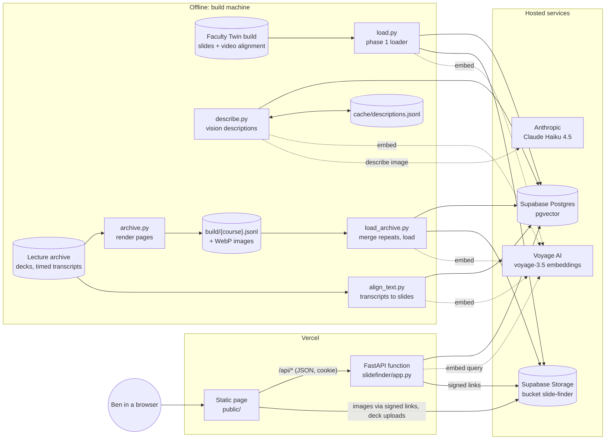

## B. Where each part runs

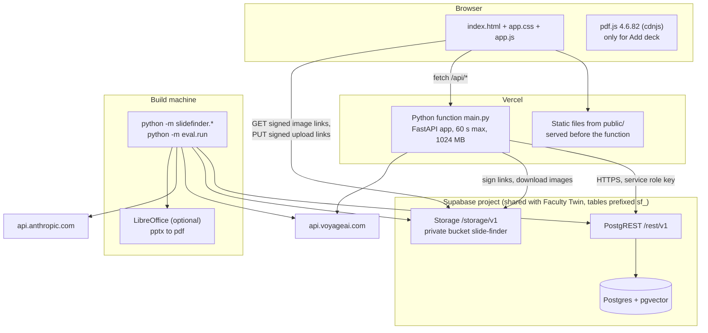

| Part | Technology | Notes |
| --- | --- | --- |
| Page | Plain HTML, CSS and one ES module (`public/`) | No framework, no build step. |
| API | FastAPI on a Vercel Python function (`main.py` imports `slidefinder.app:app`) | `vercel.json`: `maxDuration` 60 s, `memory` 1024 MB; scripts, eval, supabase and Markdown files are excluded from the bundle. |
| Database | Supabase Postgres with `pgvector` | Reached only through PostgREST over HTTPS with `httpx` (`slidefinder/db.py`); no database driver, no Supabase SDK. |
| Images | Supabase Storage, private bucket `slide-finder` | Read through signed links that last one hour. |
| Embeddings | Voyage AI `voyage-3.5`, 1024 dimensions | Documents use `input_type=document`, questions use `input_type=query`. |
| Descriptions and titles | Anthropic Claude Haiku 4.5 (`claude-haiku-4-5-20251001`) | Offline only (`describe.py`, `title.py`); never called by the web app. |
| Local run | `uvicorn slidefinder.app:app` | The same app serves `public/` itself through `StaticFiles`. |

## C. Repository map and module dependencies

| Path | What it is |
| --- | --- |
| `main.py` | Vercel entry point. Imports the FastAPI `app`. |
| `slidefinder/config.py` | Reads `.env` and the environment; holds the bucket name, model name, dimensions, phase 1 course list, skipped sessions, chunk size. |
| `slidefinder/db.py` | Thin HTTP client for PostgREST (upsert, insert, select, paged select, delete, RPC, count) and Storage (upload, signed links, signed upload links, download). |
| `slidefinder/embed.py` | Voyage calls: `embed_documents` (batches of 100) and `embed_query`. |
| `slidefinder/text.py` | Builds the embedded text: `card_text` and `said_chunks`. |
| `slidefinder/search.py` | `search()` (hybrid retrieval, fusion with `KEYWORD_WEIGHT`, merge per slide, version stacking, weak flag) and `slide_detail()`. |
| `slidefinder/app.py` | All HTTP routes, the passcode, notes, picks, PDF export, deck upload. |
| `slidefinder/load.py` | Phase 1 loader: Faculty Twin's processed build to Supabase. |
| `slidefinder/archive.py` | Phase 2 step 1: renders raw decks to WebP and writes `build/<course>.jsonl`. Never touches the database. |
| `slidefinder/load_archive.py` | Phase 2 step 2: groups repeated slides across terms, loads one copy of each. |
| `slidefinder/describe.py` | Phase 2 step 3: writes image descriptions with a vision model, stores them as `desc` items. |
| `slidefinder/align_text.py` | Phase 2 step 4: matches timed transcripts to slides by text, stores occurrences and `said` items. |
| `slidefinder/title.py` | Titles slides that have no usable text title: `--vision` reads the heading off the slide image with Claude Haiku 4.5; without it, writes one from the text and description. Rebuilds and re-embeds the slide's card and description items. |
| `supabase/migrations/001_schema.sql` | Tables, indexes, `sf_search`, `sf_exec`, row level security. |
| `supabase/migrations/002_desc_items.sql` | Adds `desc` to the allowed item kinds. |
| `supabase/migrations/003_exact_vector_scan.sql` | Makes the vector side of `sf_search` an exact scan, so large result counts are not capped by the HNSW index. |
| `public/index.html`, `app.js`, `app.css` | The page. |
| `eval/run.py` | Retrieval metrics on labeled questions. |
| `eval/step5_distances.md` | The measured distances that set the "not taught" cutoff. |
| `scripts/check_chroma.py`, `scripts/smoke_test.py` | Assignment steps 2 and 3 (Chroma). Not used by the app. |
| `docs/DEMO_SCRIPT.md` | Script for the demo video. |
| `SPEC.md`, `prompt_log.md` | Design spec and the log of prompts. |

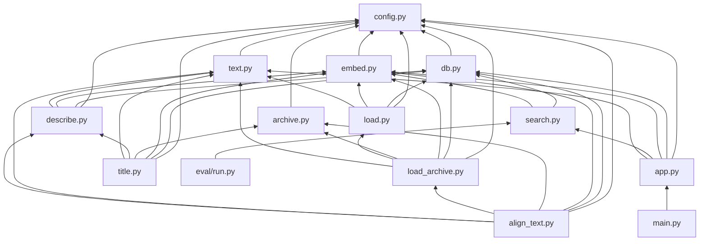

Only the top row (`main.py`, `app.py`, `search.py`, `db.py`, `embed.py`, `text.py`, `config.py`)
is deployed. The loaders import `numpy`, `python-pptx` and `anthropic`, which the web function
never loads.

## D. The database

Four tables and two SQL functions, all prefixed `sf_` because the Supabase project is shared
with Faculty Twin. Row level security is on for every table with no policies, so the anonymous
and signed-in Supabase roles can read nothing; only the service role key (held by the server and
the build machine) can read or write.

### D.1 Entity relationships

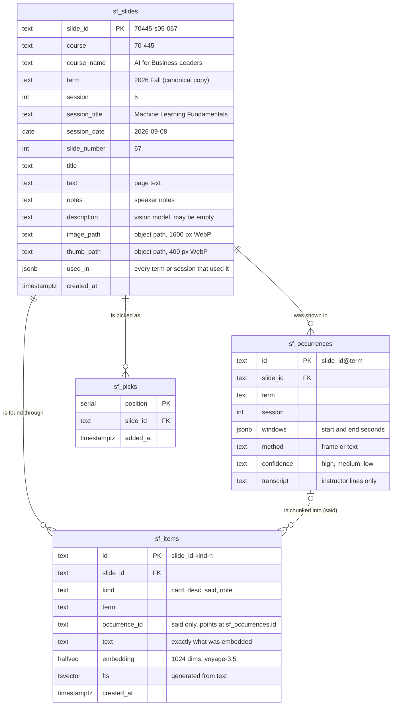

Every foreign key is `on delete cascade`: deleting a slide deletes its items, occurrences and
picks. `sf_items.occurrence_id` is a plain text column, not a declared foreign key.

### D.2 `sf_slides`: one row per unique slide

| Column | Type | Meaning | Written by |
| --- | --- | --- | --- |
| `slide_id` | text, primary key | Stable id. Formats in [D.6](#d6-id-formats). | every loader, deck upload |
| `course` | text | Course number such as `45-851`, or the label typed for an uploaded deck (default `mine`). Used by the course filter. | all |
| `course_name` | text | Human name, e.g. `Data Mining`; `My decks` for uploads. | all |
| `term` | text | Term of the copy that was indexed, e.g. `2025 Fall (A2)`. For a slide used in many terms this is the newest one. Uploads use `added`. | all |
| `session` | int | Session number within the term. Uploads get a pseudo number (current Unix time mod 100000). | all |
| `session_title` | text | Session (deck) title; for uploads, the deck name. | all |
| `session_date` | date, nullable | Date of the session, from the folder name or Faculty Twin's `deck.json`. Null for uploads. | loaders |
| `slide_number` | int | Page number within the deck, starting at 1. | all |
| `title` | text | The first page-text line that reads as a title (page numbers and links are skipped; whitespace collapsed; at most 140 characters; a line with no run of three letters is OCR noise and is skipped). When no line qualifies, the heading read off the slide image by `title.py` (858 slides), or "Slide N" for the four images the model refused to describe. | loaders, `title.py` |
| `text` | text | All page text from the PDF (PyMuPDF `get_text`, or pdf.js for uploads, capped at 8,000 characters). | all |
| `notes` | text | Speaker notes from the pptx, matched by page index; empty when the pptx and pdf page counts differ. | loaders |
| `description` | text | 60 to 90 word description of the image written by Claude Haiku 4.5. Empty until `describe.py` runs. | `describe.py` |
| `image_path` | text | Storage object path of the 1600 px wide WebP. | all |
| `thumb_path` | text | Storage object path of the 400 px wide WebP. For uploads it is the same file as `image_path`. | all |
| `used_in` | jsonb array of strings | Where the slide appeared. Archive courses: `"2025 Fall (A2) · session 4"`, one entry per session, newest first. Phase 1 courses and uploads: just the term, e.g. `["2026 Fall"]`. The page shows "used in N sessions" when there is more than one entry. | loaders |
| `created_at` | timestamptz | Insert time. | database default |

Index: `(course, session, slide_number)`.

### D.3 `sf_items`: what gets searched

Each slide has one or more items. Search runs over items, then merges them per slide
([H](#h-search-step-by-step)).

| Column | Type | Meaning |
| --- | --- | --- |
| `id` | text, primary key | Deterministic, so re-running a loader updates rows instead of adding duplicates. Formats in [D.6](#d6-id-formats). |
| `slide_id` | text, FK to `sf_slides` | The slide this item finds. |
| `kind` | text, check constraint | `card`, `desc`, `said` or `note` (`desc` added by migration 002). |
| `term` | text | Term of the slide's copy (`card`, `desc`, `note`) or of the recording (`said`). |
| `occurrence_id` | text, nullable | For `said` items, the `sf_occurrences.id` the chunk came from; null for the other kinds. |
| `text` | text | The exact text that was embedded (except notes, see [F.4](#f4-note-items)). Shown in the slide view under "What is indexed for this slide". |
| `embedding` | `halfvec(1024)` | Voyage `voyage-3.5` vector stored at half precision (2 bytes per number). Every item has one. |
| `fts` | `tsvector`, generated | `to_tsvector('english', text)`, kept in sync by Postgres. Used by keyword search. |
| `created_at` | timestamptz | Insert time. |

Indexes: HNSW on `embedding` with `halfvec_cosine_ops` (approximate nearest neighbour by cosine
distance), GIN on `fts`, B-tree on `slide_id`. Since migration 003 the search function does not
use the HNSW index (see [D.7](#d7-sf_search-hybrid-search-in-one-sql-function)); it stays in
place for when the index is large enough to need it.

| Kind | One per | What its text is | Created by |
| --- | --- | --- | --- |
| `card` | slide | Course, session, slide number and title, then the page text and speaker notes | `load.py`, `load_archive.py`, deck upload; rewritten by `describe.py --refold` and by `title.py` |
| `desc` | described slide | Course, session, slide number and title, then the vision model's description | `describe.py`; rewritten by `title.py` |
| `said` | ~120 words of transcript | `[slide title]` then a chunk of what was said while the slide was on screen | `load.py` (video-matched), `align_text.py` (text-matched) |
| `note` | note typed in the page | `[slide title]` then the note | `POST /api/notes` |

### D.4 `sf_occurrences`: what was said over a slide, per term

One row per (slide, term). The slide view lists them under "Narration".

| Column | Type | Meaning |
| --- | --- | --- |
| `id` | text, primary key | `<slide_id>@<term>` (phase 1, term written out) or `<slide_id>@<term slug>` (text alignment). |
| `slide_id` | text, FK | The canonical slide. For archive courses, a session from an older term attaches to the newest copy of the same slide. |
| `term` | text | Term of the recording. |
| `session` | int | Session of the recording (the first one, if several sessions of the same term matched the same slide). |
| `windows` | jsonb | `[[start_seconds, end_seconds], ...]` when the slide was on screen (video) or when the matched words were said (text). |
| `method` | text | `frame`: matched by comparing video frames with slide images (done in Faculty Twin's build, read by `load.py`). `text`: matched by `align_text.py`. For phase 1 rows the value is whichever method matched most of the slide's windows. |
| `confidence` | text | Phase 1: `high` when every window was matched by frame, otherwise `medium`. Text alignment: always `low`. The page labels text matches "lower confidence". |
| `transcript` | text | Instructor lines spoken in those windows, joined. Student and unclear speakers were removed before this project; raw `.vtt` files are never read. |

Index: `slide_id`.

### D.5 `sf_picks`: the working set for a new deck

| Column | Type | Meaning |
| --- | --- | --- |
| `position` | serial, primary key | Order of picking; export uses this order. Deleting a pick leaves a gap, which is harmless. |
| `slide_id` | text, FK | The picked slide. The API refuses to add the same slide twice. |
| `added_at` | timestamptz | Insert time. |

There is one shared list (the app has a single user).

### D.6 ID formats

| Thing | Format | Example |
| --- | --- | --- |
| Phase 1 slide | `<course digits>-s<NN>-<NNN>` | `70445-s05-067` |
| Archive slide | `<course digits>-<term slug>-s<NN>-<NNN>` (term slug: lower case, letters and digits only) | `45851-2023fallab2-s01-011` |
| Uploaded slide | `<deck name slug, max 40>-<6 hex>-<NNN>` | `sprint-planning-a1b2c3-004` |
| Card item | `<slide_id>-card-0` | `70445-s05-067-card-0` |
| Description item | `<slide_id>-desc-0` | `70445-s05-067-desc-0` |
| Said item, phase 1 | `<slide_id>-said-<k>` | `70445-s05-067-said-2` |
| Said item, text aligned | `<slide_id>-said-<term slug>-<k>` | `45851-2025fallm2-s01-010-said-2023fallab2-0` |
| Note item | `<slide_id>-note-<8 hex>` (random, so notes never overwrite each other) | |
| Occurrence | `<slide_id>@<term>` or `<slide_id>@<term slug>` | `70445-s05-067@2026 Fall` |

### D.7 `sf_search`: hybrid search in one SQL function

```
sf_search(query_embedding halfvec(1024), query_text text,
          match_count int default 50, course_filter text default null)
returns (id, slide_id, kind, term, text, vec_rank, fts_rank, distance, score)
```

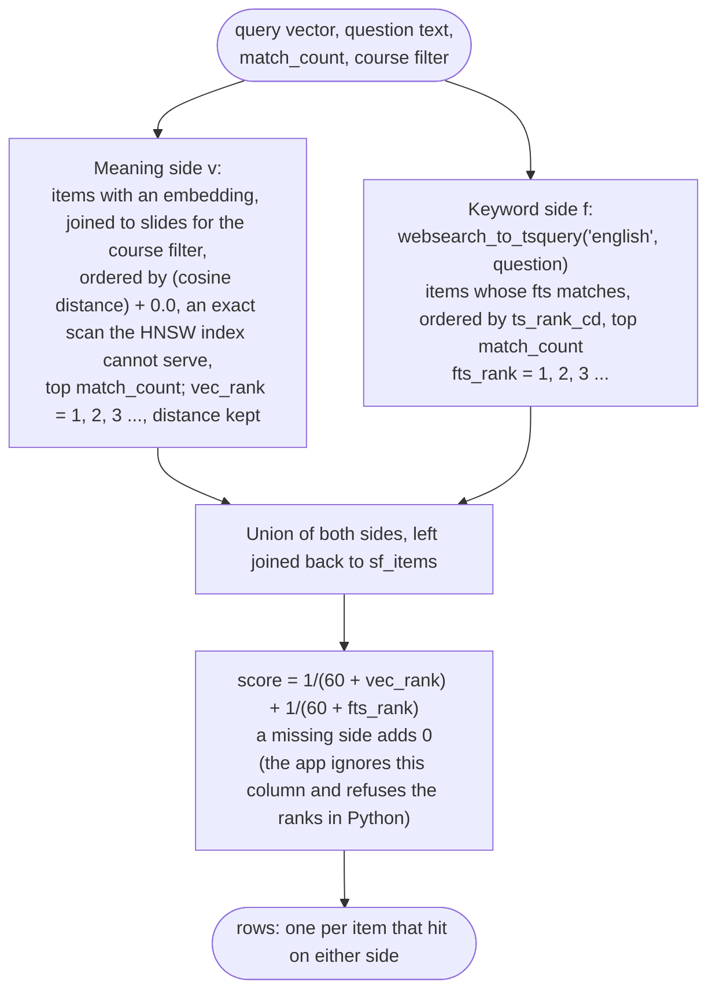

- **Distance** is pgvector's cosine distance: 0 is identical, 1 is unrelated, 2 is opposite.
- **Keyword matching** uses Postgres English stemming and stop words. `websearch_to_tsquery`
  joins plain words with AND, so every non-stop word must appear in one item. That is why long
  questions rarely get keyword hits ([section 5](#5-retrieval-scores)).
- **Reciprocal rank fusion (RRF)** with the usual constant 60. Item ranks, not raw scores, are
  combined, so the two sides do not need comparable scales. The SQL function still returns an
  equal-weight score, but `search.py` recomputes it from the ranks as
  `1/(60 + vec_rank) + KEYWORD_WEIGHT × 1/(60 + fts_rank)` with `KEYWORD_WEIGHT = 0.5`, so the
  highest possible score is 1/61 + 0.5/61 ≈ 0.0246; first on the meaning side only gives
  1/61 ≈ 0.0164, first on the keyword side only 0.0082.
- **Exact scan.** pgvector's HNSW index returns at most `hnsw.ef_search` candidates (40 by
  default) however large the `limit`, so asking for 100 slides returned about 24. Supabase does
  not allow `alter function ... set hnsw.ef_search`, so migration `003_exact_vector_scan.sql`
  orders the meaning side by `(embedding <=> query) + 0.0`, an expression the index cannot serve.
  Postgres then computes the distance for every item of the course: exact and uncapped, a few
  milliseconds at under 10,000 items.
- The app passes `match_count = max(60, 4 × n)` where `n` is the number of slides wanted, so
  each side returns 120 items at the default of 30 slides.

`sf_exec(sql text)` is a `security definer` function that runs any SQL. Only `service_role` may
execute it; it lets the build machine apply later migrations through the REST API
(`db.exec_sql`).

### D.8 What is in it now

Counts read from the live database on October 26, 2026:

| Course | Loaded by | Unique slides | Slides used in more than one session |
| --- | --- | --- | --- |
| 45-851 Data Mining (6 terms) | `archive.py` + `load_archive.py` | 879 | 484 |
| 45-885 Data Visualization (5 terms) | `archive.py` + `load_archive.py` | 725 | 555 |
| 70-445 AI for Business Leaders (2026 Fall) | `load.py` | 576 | 0 |
| 45-884 AI Methods for Social and Visual Data (2026 Fall) | `load.py` | 366 | 0 |
| 46-887 Machine Learning for Business Applications (2026 Spring) | `archive.py` + `load_archive.py` | 255 | 57 |
| **Total** | | **2,801** | **1,096** |

| Table or kind | Rows |
| --- | --- |
| `sf_slides` | 2,801 (all 2,801 have a description) |
| `sf_items` | 7,900 |
| `card` items | 2,801 |
| `desc` items | 2,801 |
| `said` items | 2,298 |
| `note` items | 0 |
| `sf_occurrences` | 1,055, on 1,032 slides (23 slides have what was said in two or more terms) |
| by video frames, high confidence | 675 |
| by video frames, medium | 11 |
| by text, medium (phase 1, mostly text-matched) | 27 |
| by text, low (`align_text.py`) | 342 |
| `sf_picks` | 2 |

The most reused slide (a Data Mining opener) lists 28 sessions in `used_in`.

### D.9 One slide, all of its rows

Slide `70445-s05-067` ("The sweet spot, a balance of bias and variance"). Long text is cut here.

```
sf_slides       slide_id 70445-s05-067 · course 70-445 · term 2026 Fall · session 5
                "Machine Learning Fundamentals" · slide_number 67 · used_in ["2026 Fall"]
                image_path slides/70445/70445-s05-067.webp
                thumb_path slides/70445/70445-s05-067-thumb.webp
sf_items        70445-s05-067-card-0   card  240 words  "AI for Business Leaders, Machine Learning
                                                         Fundamentals, slide 67: The sweet spot, ...
                                                         Speaker notes: This graph illustrates ..."
                70445-s05-067-desc-0   desc  106 words  "... slide 67: The sweet spot, ...
                                                         The slide displays a graph plotting model
                                                         complexity against error rate ..."
                70445-s05-067-said-0   said  129 words  "[The sweet spot, a balance of bias and variance] ..."
                70445-s05-067-said-1   said  115 words
                70445-s05-067-said-2   said   63 words
sf_occurrences  70445-s05-067@2026 Fall · session 5 · windows [[4073.0, 4153.0]]
                method frame · confidence high · transcript (the three said chunks, unsplit)
```

This is the slide the README's first example query finds with no words in common. It wins
through the `said` items.

## E. Image storage

Private Supabase Storage bucket `slide-finder`. Nothing in it is public. The server signs links
that expire after one hour (`db.signed_urls`, one batched call per page of results).

```
slide-finder/
  slides/<course digits>/<slide_id>.webp          1600 px wide, WebP quality 80
  slides/<course digits>/<slide_id>-thumb.webp     400 px wide, WebP quality 75
  uploads/<deck_id>/<NNN>.webp                     uploaded decks: 1600 px wide, WebP quality 0.82,
                                                   used as both image and thumbnail
```

Uploads from the build machine use `x-upsert: true` and retry up to four times on a 5xx
response, because Storage returns the odd 502 under parallel load (`db.upload`, four threads).
Browser uploads go straight to Storage with one-time signed upload links, so the image bytes
never pass through the Vercel function (whose request body limit is 4.5 MB).

## F. What text gets embedded, exactly

All text is embedded with Voyage `voyage-3.5`, 1024 dimensions, `input_type=document`, 100
texts per request. Questions are embedded with `input_type=query`.

### F.1 Card items (`text.card_text`)

```
<course_name>, <session_title>, slide <n>: <title>       header line (": " dropped if no title)
<page text with the title removed from its start>         if any
<description>                                             only when a caller passes one (see below)
Speaker notes: <first 220 words of the notes>            if any
```

The card stored in the database never includes the description (it is its own `desc` item).
`align_text.py` passes the description only when it builds the in-memory slide text it compares
transcripts against.

### F.2 Description items (`describe.desc_text`)

```
<course_name>, <session_title>, slide <n>: <title>
<description>
```

### F.3 Said items (`text.said_chunks`)

1. Split the transcript into sentences after `.`, `!` or `?`.
2. Pack whole sentences into chunks of at most 120 words (a single longer sentence becomes its
   own chunk).
3. If the last chunk is under 25 words, append it to the one before.
4. Prefix every chunk with `[<slide title>] ` (omitted when the slide has no title).

Every item stays far below Voyage's 32,000 token input limit, so nothing is cut off silently.

### F.4 Note items

Stored text is `[<slide title>] <note>`, with whitespace collapsed. The embedding is computed from
the note alone, without the title prefix. Keyword search uses the stored text, so it does see the
title.

### F.5 Uploaded deck cards

`card_text(course_name, deck name, page, title, page text, notes="")`. There are no speaker notes
and no description for uploaded decks.

## G. Offline pipelines: how the index is built

### G.1 Overview and order

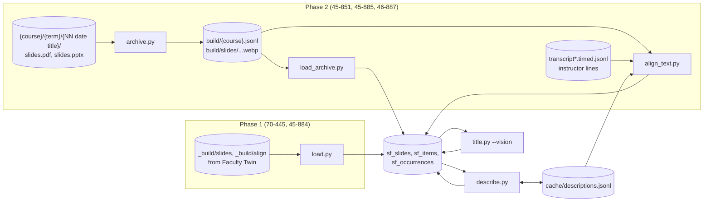

For an archive course, the scripts must run in this order, because each depends on the one
before:

```
python -m slidefinder.archive 45-851        # render pages to build/
python -m slidefinder.load_archive 45-851   # merge repeats, load slides and cards (deletes the course first)
python -m slidefinder.describe --course 45-851    # descriptions as desc items (cache makes re-runs free)
python -m slidefinder.align_text 45-851     # transcripts as occurrences and said items
python -m slidefinder.title --vision --yes  # titles for slides with no text title (all courses; cheap)
```

`load_archive.py` begins by deleting every `sf_slides` row of the course. Because of the cascades
that also removes the course's `desc`, `said` and `note` items, its occurrences and its picks.
After a reload, `describe.py` (served from its cache, so nothing is paid again) and
`align_text.py` must run again. Notes typed in the page for that course are lost.

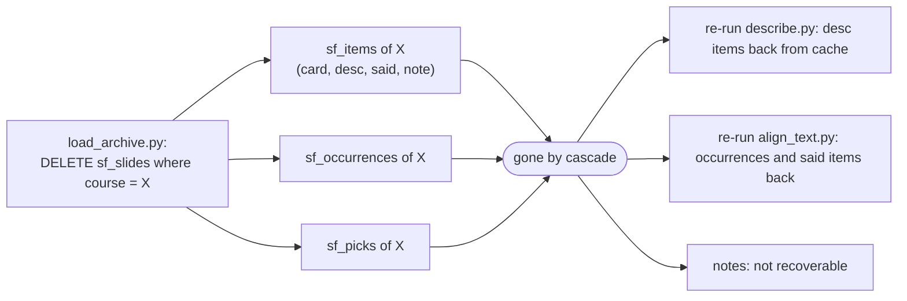

### G.2 Phase 1 loader (`load.py`)

Reads Faculty Twin's processed build under `$LECTURE_ARCHIVE/_build` as input data. No Faculty
Twin code is imported.

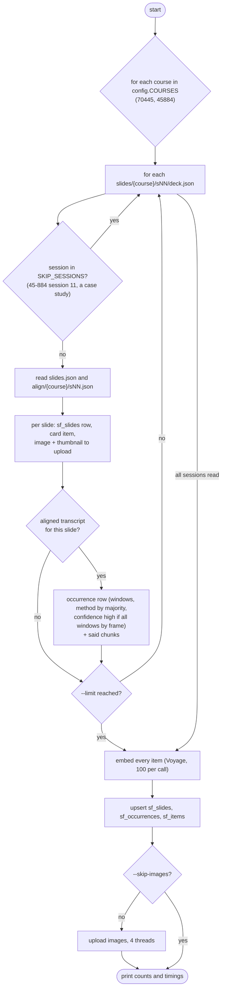

Phase 1 courses are not merged for repeats: each slide of the single term is its own row.

### G.3 Rendering raw decks (`archive.py`)

Input layout: `$LECTURE_ARCHIVE/<course number and name>/<YYYY Season (section)>/<NN YYYY-MM-DD
title>/` containing `slides.pdf` and/or `slides.pptx`.

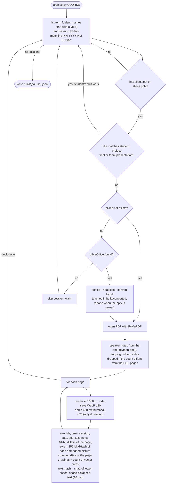

The title is the first text line that reads as one (`title_of`): page numbers, links and OCR
noise above it are skipped. Pages with no such line stay untitled until `title.py` runs
([G.8](#g8-titling-slides-titlepy)).

The difference hash (`dhash`) shrinks the page to 9 × 8 grey pixels and records, for each of the
64 neighbouring pairs, whether the left pixel is brighter than the right. Similar-looking pages
have hashes that differ in few bits (Hamming distance). The same hash at 17 × 16 (256 bits) is
taken of each picture embedded in the page, read from the image file rather than the rendered
page, so a picture keeps its hash when the slide moves to a new term's template. Near-flat
pictures (tints, overlays, placeholders) are ignored, since they look alike everywhere.

### G.4 Merging repeated slides (`load_archive.py`)

The same slide appears in many terms, often with small edits. One copy is indexed and every
session that used it is recorded in `used_in`. Pages are joined with union-find (so A=B and B=C
puts A, B and C together) when any rule holds:

| Rule | Applies to | Joined when |
| --- | --- | --- |
| A. Same text | Pages with at least 5 words | Same `text_hash`, and the same pictures (largest picture within 24 of 256 bits and every picture matched on both sides), or no pictures on either page and the pages within 12 bits or similar drawing counts; 25 or more words counts on its own |
| B. Same meaning and look | Both pages with at least 5 words | Card embeddings have cosine similarity ≥ 0.95 **and** either the pages are within 10 bits with the pictures not contradicting, or (across terms, not on a title slide) the same pictures |
| C. Same picture | Both pages with fewer than 5 words | Same `text_hash` and the same pictures, or 256-bit dHash of the thumbnails (17 × 16 grey) within 6 bits |

Pictures match as a set (same count, largest the same, each matched), so a page that adds a
figure (a build-up step) and a stock picture under different titles both stay separate. The
24-bit threshold comes from the data: identical-text pairs across terms have picture distances
under 24 bits (re-encoded copies) or over 40 (different pictures), with nothing in between.

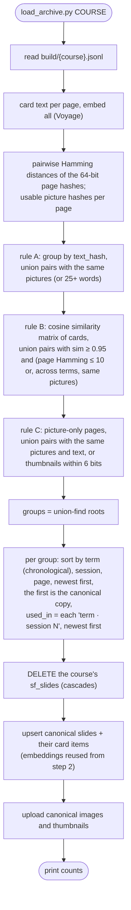

Terms sort chronologically through `term_key`: `"2025 Spring (M4)"` becomes `(2025, 1, "M4")`,
with Spring = 1, Summer = 2, Fall = 3. Grouping is done within one course at a time, so the same
slide used in two courses stays two rows.

This grouping is a second use of the embeddings, besides search.

### G.5 Image descriptions (`describe.py`)

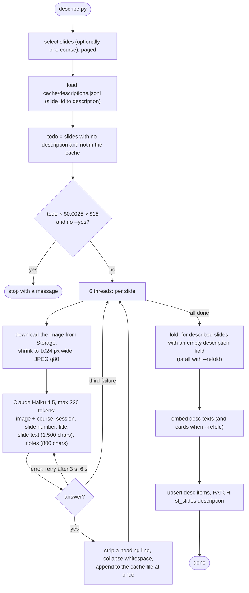

The prompt asks for 60 to 90 words of plain prose: what the slide shows (chart and what it plots,
diagram and parts, code and what it does, photo, table, quote), the concept it teaches, and any
methods, tools, companies or examples visible, without repeating the slide text. The cache is
keyed by `slide_id`, so it survives a database reload and a re-run costs nothing.

### G.6 Matching transcripts to slides by text (`align_text.py`)

Used for archive courses, which have timed transcripts but no video alignment.

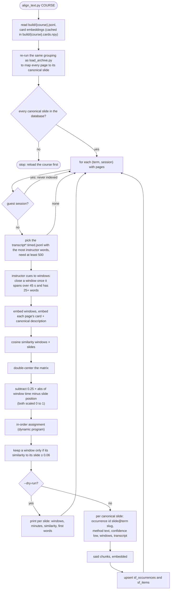

**Double-centering.** With `raw[w, s]` the cosine similarity of window `w` and slide `s`:

```
sim[w, s] = raw[w, s] − mean over slides of raw[w, ·] − mean over windows of raw[·, s] + mean of raw
```

A generic slide that resembles every window, or chatter that resembles every slide, no longer
wins by default.

**Time prior.** Window midpoints are scaled to 0..1 across the session, slide positions to 0..1
across the deck, and `0.25 × |t − position|` is subtracted. A window from the first minutes is
unlikely to belong to the last slide.

**Assignment.** `dp[w, s]` is the best total similarity of any path that puts window `w` on slide
`s`:

```
dp[0, s] = sim[0, s]
dp[w, s] = sim[w, s] + max over k of ( dp[w − 1, k] − penalty(s − k) )

penalty(d) = min(max(d − 1, 0) × 0.015, 0.15)   for d ≥ 0   (staying or moving to the next slide is free;
                                                             skipping slides costs 0.015 each, at most 0.15)
penalty(d) = 0.08                               for d < 0   (going back, any distance)
```

The best final slide is traced back to give one slide per window. Windows whose similarity on
their slide is below 0.06 are dropped as admin talk, chatter or Q&A.

### G.7 What a timed transcript line looks like

Only these fields are read; files are already de-identified before this project.

```
{"start_seconds": 1419.8, "end_seconds": 1424.1, "speaker": "instructor", "text": "..."}
```

Lines with `speaker` other than `instructor` (`student`, `unclear`) are ignored.

### G.8 Titling slides (`title.py`)

858 slides had no usable text title: the heading was part of a picture, or the first text line
was a page number or a link. `python -m slidefinder.title --vision --yes` selects those slides
(the ones whose text yields no title by the rule in G.3), sends each slide image (1024 px JPEG)
to Claude Haiku 4.5 with "return the heading printed on this slide exactly as written, or a 3 to
7 word title if there is none", writes the answer to `sf_slides.title`, rebuilds the slide's
`card` and `desc` item texts (both start with the title) and re-embeds them. Without `--vision`
it works from the extracted text and the image description alone, which is cheaper but
paraphrases ("Business Advantages of Customer Segmentation" for a slide that says "Benefits of
Customer Segmentation"), so the vision pass is the one in use. 32 vision answers came back as
prose ("I don't see a heading printed on this slide...") and were replaced by short titles; the
four slides whose image the model refused to describe are titled "Slide N". Cost: about $2 for
all 858.

## H. Search, step by step

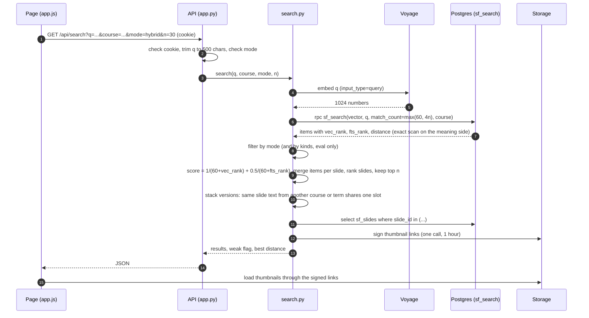

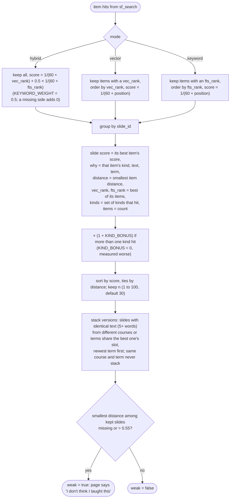

The response of `GET /api/search`:

```
{
  "question": "...", "mode": "hybrid", "n": 30, "kind_bonus": 0.0,
  "weak": false, "best_distance": 0.502,
  "results": [
    {
      "slide_id": "70445-s05-067",
      "score": 0.0164, "raw_score": 0.0164,      // fused score (raw = before any kind bonus)
      "distance": 0.502,                          // closest item, cosine distance
      "vec_rank": 1, "fts_rank": null,            // best item rank on each side
      "kinds": ["card", "said"], "items": 4,      // kinds that hit, number of items that hit
      "why": {"kind": "said", "text": "[The sweet spot, ...] ...", "term": "2026 Fall"},
      "slide": {"slide_id", "course", "course_name", "term", "session", "session_title",
                "slide_number", "title", "text", "used_in"},
      "thumb": "https://<project>.supabase.co/storage/v1/object/sign/...  (1 hour)",
      "versions": [ { ...the same fields, one per version of this slide, newest term first... } ]
    }
  ]
}
```

`versions` holds every copy of the slide that landed in the results (one entry when there is
only this copy). The page draws a result with several versions as a stacked card with one tab
per version, labeled with the term and course ("Fall 2026 · AI for Business Leaders"); the tab
swaps in that version's thumbnail, scores and why line. Copies are versions of one slide when
their slide text is identical and at least five words (`search.family_key`); two copies from the
same course and term are never stacked, since those are different slides sharing a caption.

The 0.55 cutoff comes from `eval/step5_distances.md`: the best distance for on-topic questions
was 0.46 to 0.50 and for off-topic questions 0.58 to 0.60.

## I. Runtime flows

### I.1 Passcode

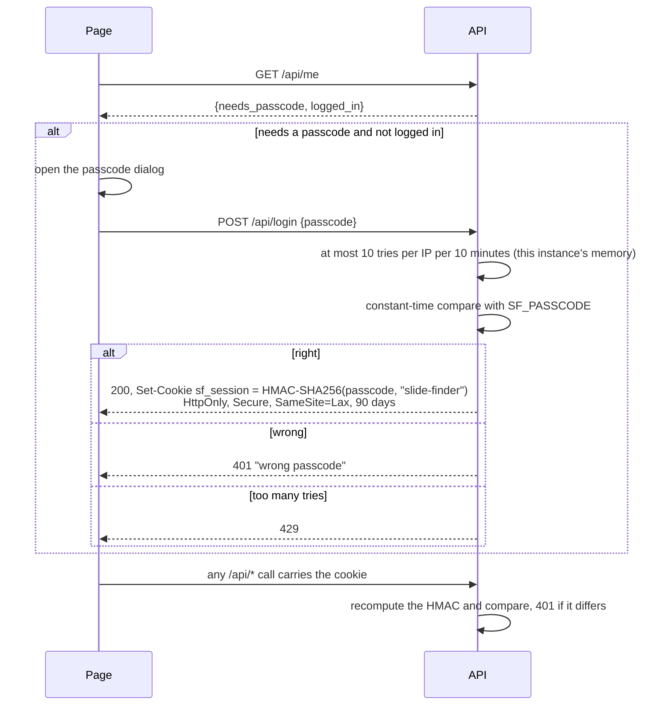

Changing `SF_PASSCODE` changes the expected cookie value, which signs everyone out. With no
passcode set (a local run), every route is open.

### I.2 Opening a slide

```mermaid
sequenceDiagram
    participant P as Page
    participant A as API
    participant D as Postgres
    participant ST as Storage
    P->>A: GET /api/slide/{slide_id}
    A->>D: sf_slides row
    A->>D: sf_occurrences for the slide, ordered by term (text order, descending)
    A->>A: sort items card, desc, said, note, notes = note items
    A->>ST: sign image and thumbnail links
    A->>D: sf_items for the slide (id, kind, term, occurrence_id, text, created_at)
    A-->>P: {slide, image, occurrences, notes, items}
    P->>P: dialog, two scrolling columns.<br/>Left: full image, "What is indexed" (every item with its word count;<br/>narration chunks with their term and "part k of n"), notes, note box.<br/>Right: title, where it is, Pick and Open image, "Narration" per term<br/>(first window, minutes on screen, matched by video or by text)
```

### I.3 Adding a note

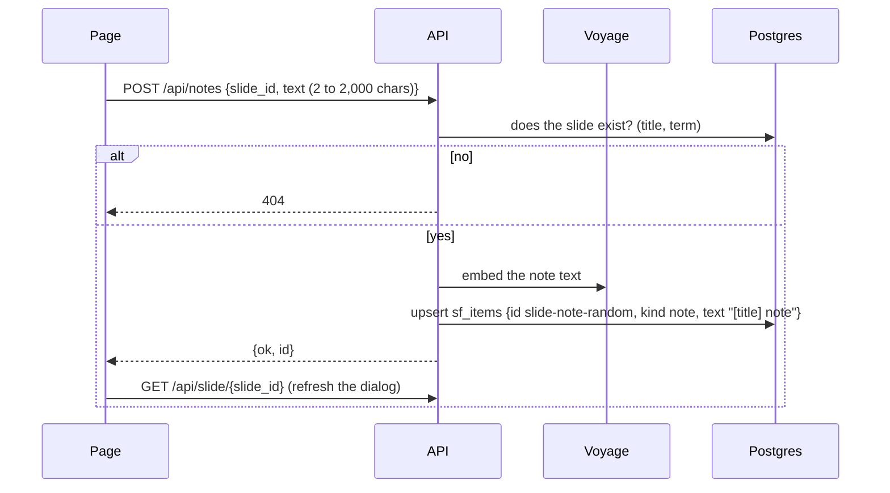

The note is searchable on the very next query; the HNSW and GIN indexes update on insert.

### I.4 Adding a deck from the browser

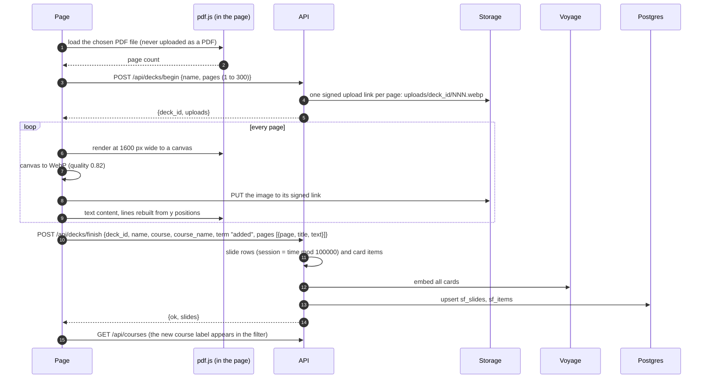

### I.5 Picking slides and exporting a PDF

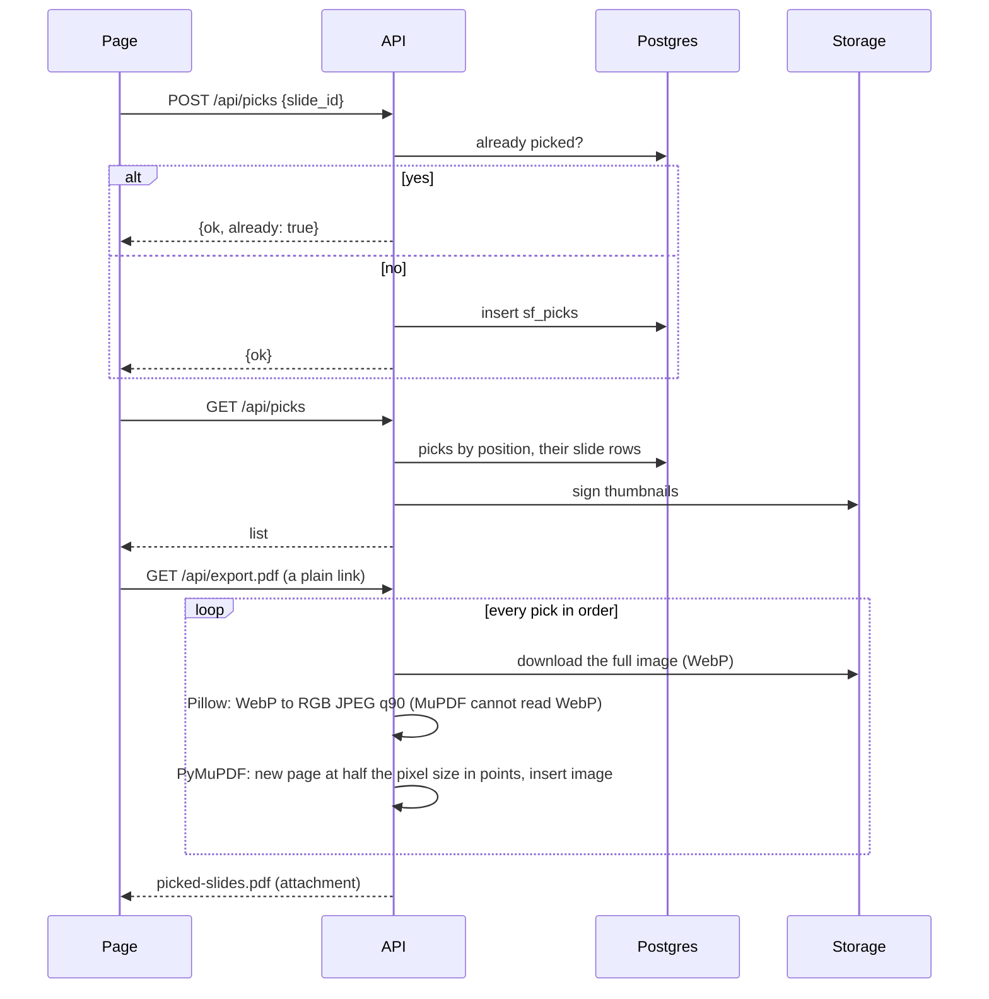

## J. HTTP API reference

All routes except `/api/login` and `/api/me` require the passcode cookie when `SF_PASSCODE` is
set. Errors come back as `{"detail": "..."}` with the status shown. FastAPI's own docs pages are
turned off.

| Method and path | Input | Output | Errors |
| --- | --- | --- | --- |
| `POST /api/login` | `{passcode}` (max 200 chars) | `{ok: true}` and the cookie | 401 wrong, 429 more than 10 tries in 10 minutes |
| `GET /api/me` | | `{needs_passcode, logged_in}` | |
| `GET /api/search` | `q` (required, cut to 500 chars), `course` (exact course value, optional), `mode` = `hybrid`, `vector` or `keyword`, `n` (clamped to 1..100, default 30) | See [H](#h-search-step-by-step) | 400 empty question or bad mode |
| `GET /api/slide/{slide_id}` | | `{slide (full row), image (signed link), occurrences, notes, items}` | 404 |
| `GET /api/courses` | | `[{course, course_name, terms}]`, where terms are the terms of indexed copies | |
| `POST /api/notes` | `{slide_id (max 80), text (2 to 2,000)}` | `{ok, id}` | 404 no such slide, 422 validation |
| `GET /api/picks` | | `[{position, slide_id, added_at, slide, thumb}]` | |
| `POST /api/picks` | `{slide_id}` | `{ok}` or `{ok, already: true}` | |
| `DELETE /api/picks/{position}` | | `{ok}` | |
| `GET /api/export.pdf` | | PDF, `Content-Disposition: attachment; filename="picked-slides.pdf"` | 400 nothing picked |
| `POST /api/decks/begin` | `{name (1 to 120), pages (1 to 300)}` | `{deck_id, uploads: [{page, path, url, token}]}` | 422 |
| `POST /api/decks/finish` | `{deck_id (a-z, 0-9, -), name, course (max 20, default mine), course_name, term (default added), pages: [{page, title (max 300), text (max 8,000)}]}` | `{ok, slides}` | 422 |

Validation is done with Pydantic models; anything outside the stated limits returns 422.

## K. The page

One HTML file with four `<dialog>` elements and one ES module, `app.js`. No framework.

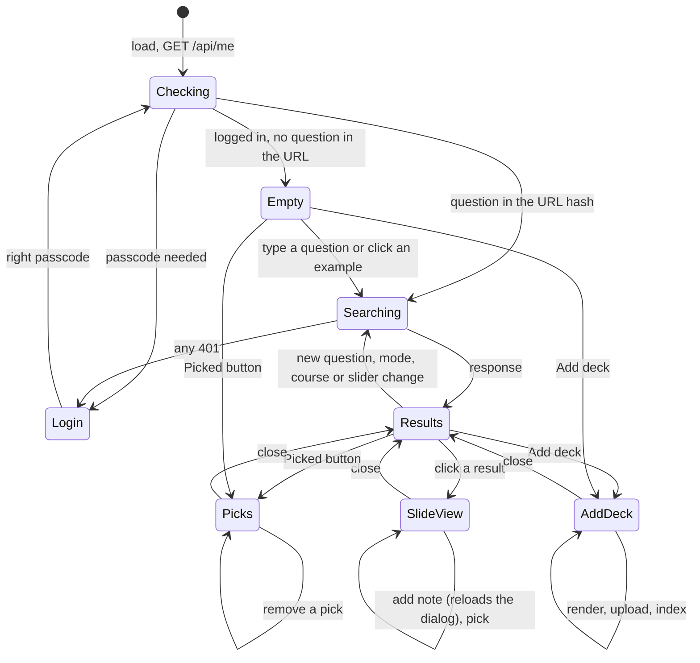

| Element | What it shows or does |
| --- | --- |
| Search bar | Question box, course filter (filled from `/api/courses`), "Find slides". |
| Tools | "Show" slider (5 to 100 results, step 5, default 30, remembered in `localStorage` key `sf_n`), search mode (meaning + keywords, meaning only, keywords only), Picked count, Add deck. |
| Status line | Number of slides and best distance, or the "I don't think I taught this" warning with the distance. |
| Result card | Thumbnail, rank and title, course, term, session and slide number, "used in N sessions", the kinds that matched (card, image, narration, note), score details (score, distance, meaning rank, keyword rank, items hit; a tooltip explains each) and "why": the best item's text, labeled "Slide says", "Image shows", "Narration" or "My note". A slide with versions in other courses or terms is one stacked card with "N versions" and a tab per version ("Fall 2026 · AI for Business Leaders"); a tab swaps in that version. |
| Slide dialog | Two columns that scroll on their own. Left: the full image, "What is indexed for this slide" (every item with its id and word count; narration chunks also show their term and "part k of n"), notes and a note box. Right: title, where it is and where else it was used, Pick for new deck, Open image, and "Narration" per term (first time window, minutes on screen, matched by video or by text with a lower-confidence label; long text collapses). |
| Picks dialog | Picked slides in order with Remove buttons; Export PDF. |
| Add deck dialog | File, deck name (defaults to the file name), course label (default `mine`), progress line. pdf.js is imported only when a deck is added. |
| Empty state | Ten example questions that are known to work. |

The question is kept in the URL hash, so a search can be bookmarked or reloaded. All text from
the server is HTML-escaped before it is inserted into the page.

## L. Security and privacy

| Concern | How it is handled |
| --- | --- |
| Database keys | The service role key lives only in the Vercel environment and the build machine's `.env`. The browser never receives a key; it only talks to `/api/*` and to signed Storage links. |
| Database access | Row level security is on with no policies, so Supabase's public roles see nothing. `sf_exec` can be run only by the service role. |
| Images | Private bucket; every link is signed and expires in one hour. Upload links are one-time and tied to one object path. |
| Login | A single passcode. The cookie holds an HMAC of a fixed string keyed by the passcode, never the passcode itself. Comparisons are constant-time. HttpOnly, Secure, SameSite=Lax. |
| Guessing | 10 login attempts per IP per 10 minutes. The counter lives in the function instance's memory, so it resets when Vercel starts a new instance. |
| Browser hardening | `vercel.json` sets a Content Security Policy (scripts only from the site and cdnjs; images and connections only to the site and `*.supabase.co`; no frames, no plugins), `X-Frame-Options: DENY`, `X-Content-Type-Options: nosniff`, `Referrer-Policy: no-referrer`, HSTS for two years, and `X-Robots-Tag: noindex, nofollow`. |
| Students | Transcripts were de-identified before this project, and only `instructor` lines are read. Raw `.vtt` captions are never read. Sessions titled as student, project, final or team presentations are not rendered. Guest-speaker sessions are skipped in text alignment. One case-study session is skipped entirely. |
| Repository | `.gitignore` keeps out `build/`, `cache/`, `data/`, `chroma_store/`, every `.pdf` and `.pptx`, and every `.env*`. `.vercelignore` keeps the same and the loaders out of the deployment. |
| Eval questions | Read from a private path (`FT_EVAL_PATH`); only aggregate scores are written to the repo. |

## M. Configuration and tunable constants

### M.1 Environment variables

| Name | Needed by | Purpose |
| --- | --- | --- |
| `SUPABASE_URL` | web, loaders | Project URL. |
| `SUPABASE_SERVICE_ROLE_KEY` | web, loaders | Server key for PostgREST and Storage. |
| `VOYAGE_API_KEY` | web, loaders | Embeddings. |
| `SF_PASSCODE` | web | The passcode; empty means no login. |
| `ANTHROPIC_API_KEY` | `describe.py` | Image descriptions. |
| `LECTURE_ARCHIVE` | loaders | Archive root, default `~/Lecture Archive`; Faculty Twin's build is read from `_build` inside it. |
| `FT_EVAL_PATH` | `eval/run.py` | Private labeled questions (JSON lines). |
| `STORE` | nothing | Listed in `.env.example` for a planned local Chroma mode that the code does not implement (see [O](#o-known-limits-and-differences-from-specmd)). |

### M.2 Constants

| Constant | Value | Where | Effect |
| --- | --- | --- | --- |
| `EMBED_MODEL`, `EMBED_DIMS` | `voyage-3.5`, 1024 | `config.py` | Must match `halfvec(1024)` in the schema. |
| `BATCH` | 100 | `embed.py` | Texts per Voyage request. |
| `SAID_CHUNK_WORDS` | 120 | `config.py` | Size of `said` chunks. |
| `WEAK_DISTANCE` | 0.55 | `search.py` | "Not taught" cutoff. |
| `TOP_SLIDES`, `MAX_SLIDES` | 30, 100 | `search.py` | Default and maximum number of slides returned. |
| `KIND_BONUS` | 0.0 | `search.py` | Bonus for slides hit by more than one kind; 0.15 measured worse. |
| `KEYWORD_WEIGHT` | 0.5 | `search.py` | A keyword rank counts half a meaning rank in the fused score. |
| RRF constant | 60 | `sf_search`, `search.py` | Rank fusion. |
| `match_count` | max(60, 4n) | `search.py` | Candidates per side. |
| `IMAGE_WIDTH`, `THUMB_WIDTH` | 1600, 400 px | `archive.py` | Rendered sizes. |
| `SIM`, `HAMMING` | 0.95, 10 bits | `load_archive.py` | Rule B for repeated slides. |
| `PIC_BITS` | 24 of 256 bits | `load_archive.py` | Two embedded pictures this close are the same picture. |
| Rule A, C thresholds | 12 bits / 25 words / 25 drawings; 6 of 256 bits | `load_archive.py` | Rules A and C. |
| `MODEL` | `claude-haiku-4-5-20251001` | `describe.py`, `title.py` | Vision model for descriptions and titles. |
| `COST_PER_SLIDE`, `COST_CAP` | $0.0025, $15 | `describe.py` | Cost guard before describing. |
| `WINDOW_SECONDS`, `MIN_WINDOW_WORDS` | 45 s, 25 words | `align_text.py` | Transcript windows. |
| `MIN_INSTRUCTOR_WORDS` | 500 | `align_text.py` | Minimum transcript size for a session. |
| `FORWARD_STEP`, `MAX_FORWARD`, `BACK_PENALTY` | 0.015, 0.15, 0.08 | `align_text.py` | Assignment penalties. |
| `TIME_PRIOR` | 0.25 | `align_text.py` | Weight of the clock. |
| `MIN_SIM` | 0.06 | `align_text.py` | Windows below this are dropped. |
| `SKIP_SESSIONS`, `SKIP_TITLE`, `GUEST` | see code | `config.py`, `archive.py`, `align_text.py` | Material kept out of the index. |
| Passcode cookie lifetime | 90 days | `app.py` | |
| Signed link lifetime | 3,600 s | `db.py` | |
| Function limits | 60 s, 1024 MB | `vercel.json` | Bounds search and export time. |

## N. Evaluation harness

`python -m eval.run` reads the private question file. Each line has a `question`, a `type`, an
optional `course` and, for answerable questions, `expected_slides` (one or more slide ids). It
runs every question through the same `search()` the app uses, with `n = 10` and the course filter
set to the question's course.

| Metric | Definition |
| --- | --- |
| hit@1 | Share of answerable questions whose first result is an expected slide (plain-words versions of all five are in [section 5](#5-retrieval-scores)). |
| hit@5 | Share with an expected slide in the top 5. |
| recall@10 | Mean over questions of (expected slides in the top 10) ÷ (expected slides). |
| MRR | Mean of 1 ÷ rank of the first expected slide, 0 when none is in the top 10. |
| off-topic flagged | Off-topic questions that came back with `weak = true`, out of all off-topic questions. |

It prints one row each for `hybrid`, `vector` and `keyword`, plus `hybrid` restricted to the
`card`, `said` and `note` kinds (the "without descriptions" row), and lists the missed questions.
The kind restriction is applied after the database returns its candidates, so `desc` items still
take candidate places in that run. The scores are in [section 5](#5-retrieval-scores).

## O. Known limits and differences from SPEC.md

- **No local Chroma mode.** `SPEC.md` describes `STORE=chroma` for running without keys. The code
  has no `store.py`; the app always uses Supabase and Voyage. Chroma appears only in the step 2
  and 3 scripts.
- **Dependencies.** `requirements.txt` covers the web app. The loaders also need `numpy` and
  `python-pptx` (`requirements-build.txt`) and `anthropic` (for `describe.py`, not listed in any
  requirements file). LibreOffice is needed only for sessions that have a pptx and no pdf.
- **Reloading a course** deletes its notes, picks, descriptions and transcripts by cascade
  ([G.1](#g1-overview-and-order)).
- **Uploaded decks** get a new random `deck_id` each time, so adding the same PDF twice makes two
  copies. If the upload stops between `begin` and `finish`, the images already sent stay in
  Storage with no rows pointing at them. Uploaded slides have no notes, description or
  transcript, and use the full image as the thumbnail.
- **Repeats across courses** are not merged in the database (grouping runs per course, so each
  course keeps its own narration); the search stacks them into one result instead. Phase 1
  courses are not merged within their term.
- **The HNSW index is built but unused** by `sf_search` since migration 003 (exact scan). At a
  much larger index the function would need the index back, with a way to raise
  `hnsw.ef_search`.
- **Term order in the slide view** is text order, so "2026 Spring" sorts before "2026 Fall".
- **Picks** are one shared list, not per person.
- **Login rate limit** is per function instance, so it is a brake rather than a guarantee.
- **Export size** is bounded by the 60 second function limit, since every image is downloaded
  and converted in one request.
- **Video alignment** for archive courses is not built yet; their transcripts are matched by text
  only and labeled lower confidence.

## P. Glossary

| Term | Meaning here |
| --- | --- |
| Slide | One unique slide; repeats across terms are one slide with several `used_in` entries. |
| Item | One embedded text that points at a slide (`card`, `desc`, `said`, `note`). |
| Occurrence | One term's record of a slide being on screen, with what was said. |
| Canonical copy | The newest-term version of a repeated slide; the one that is indexed and shown. |
| Embedding | 1024 numbers from Voyage that place a text so that similar meanings sit close together. |
| Cosine distance | 1 − cosine similarity of two embeddings; 0 means the same direction. |
| HNSW | The approximate nearest-neighbour index pgvector uses for fast vector search; built here but bypassed by the search function (exact scan, migration 003). |
| Narration | The page's label for what I said while a slide was on screen (the `said` items and the occurrence records). |
| Version stack | One result slot holding every copy of a slide that other courses or terms have, with a tab per copy. |
| `tsvector` / `tsquery` | Postgres full-text search: stemmed words of a document / of a query. |
| RRF | Reciprocal rank fusion: add 1/(60 + rank) from each ranking; here the keyword ranking's share is halved. |
| dHash | Difference hash: a few dozen bits summarizing an image's brightness pattern. |
| Hamming distance | Number of differing bits between two hashes. |
| Phase 1 / phase 2 | Faculty Twin's processed single-term build / the raw archive across every term. |
