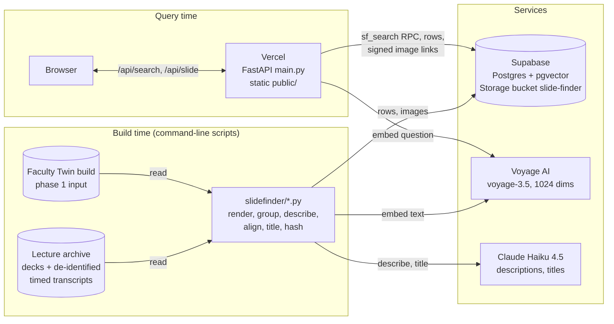
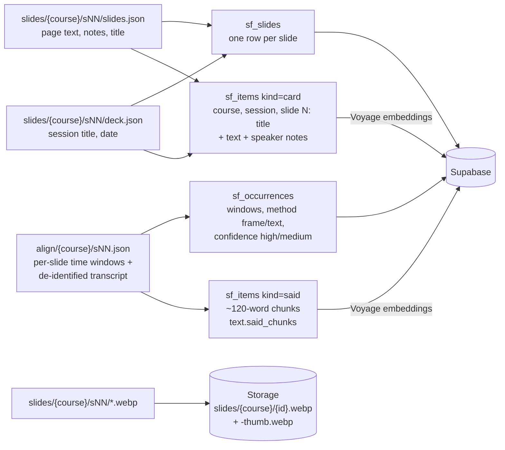
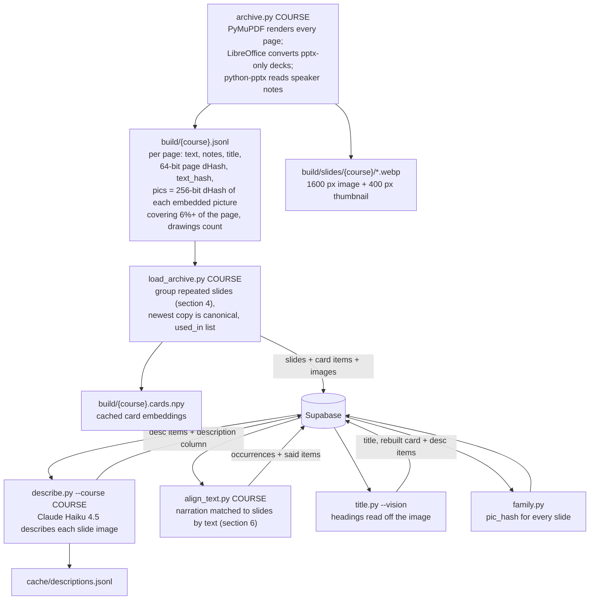
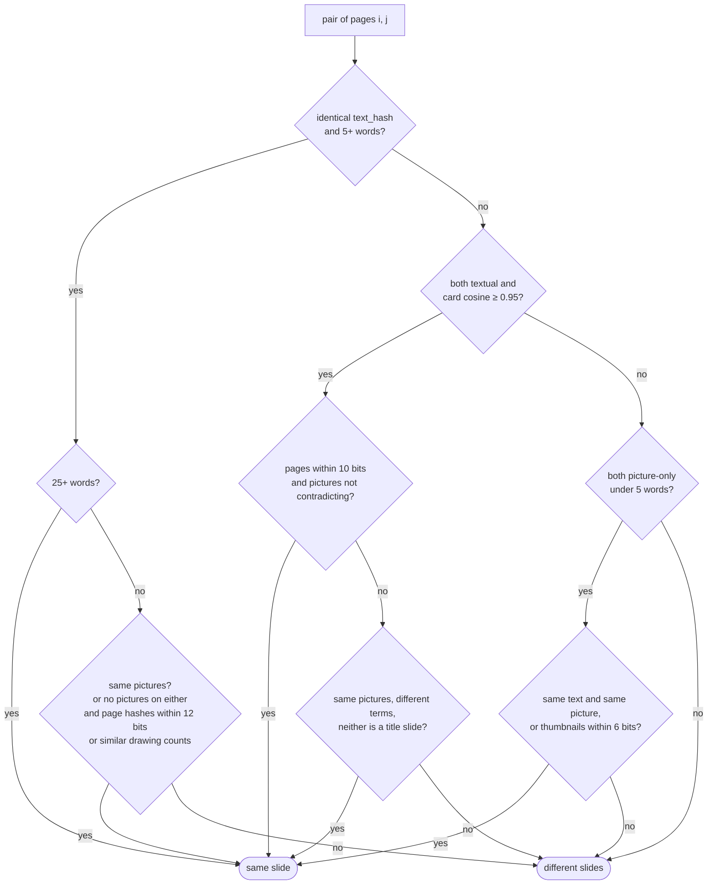
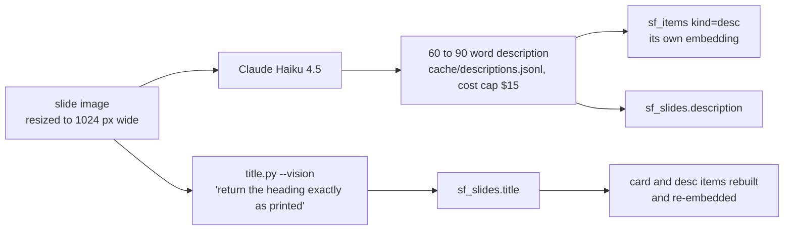
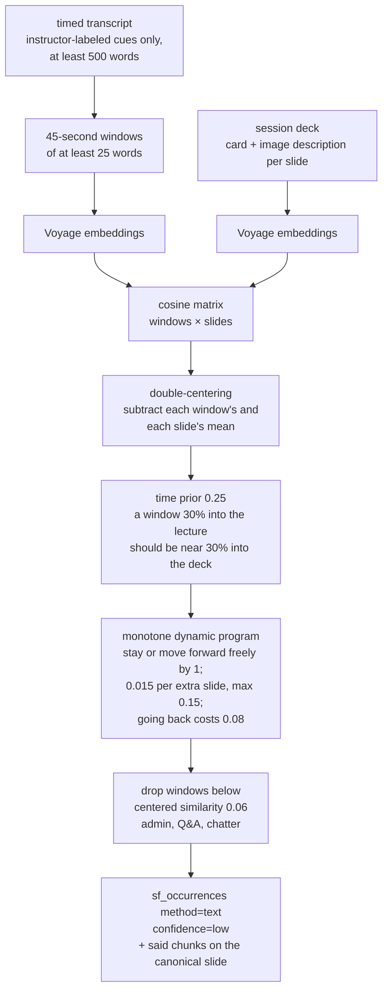
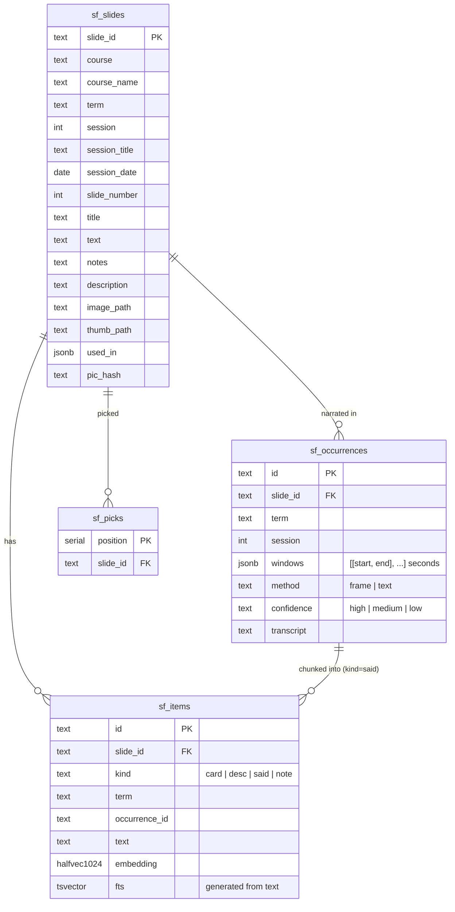
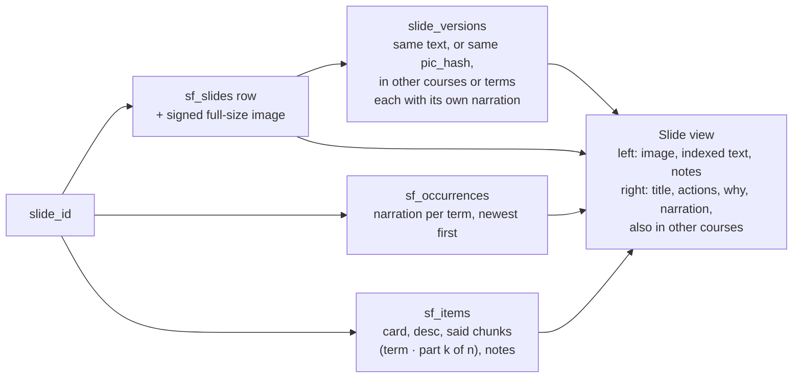
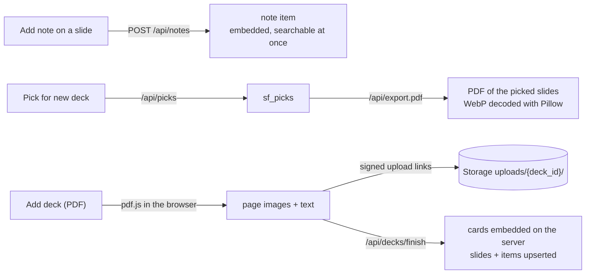

# Slide Finder: how it works

One document for anyone who wants to understand the system end to end: where the data comes
from, how it is turned into searchable items, how a question becomes a ranked list of slides,
and what the page shows about each match. Diagrams are Mermaid (GitHub renders them); each is
followed by a plain-English walk-through. Counts are from the live database on October 26, 2026.

| What | How many |
| --- | --- |
| Unique slides | 2,801 (from 5,623 deck pages across five courses) |
| Searchable items | 7,900 (2,801 slide cards, 2,801 image descriptions, 2,298 narration chunks) |
| Narration records (one per slide and term) | 1,055 on 1,032 slides |
| Slides used in more than one session | 1,096 |

## 1. Overview



Everything on the left runs on a machine with the lecture archive, once per course, and writes
rows and images into Supabase. The web app never sees the archive: at query time it embeds the
question with Voyage, calls one SQL function, and reads rows and signed image links from
Supabase. Claude Haiku is used only at build time.

## 2. Loading, phase 1: the Faculty Twin build (`slidefinder/load.py`)



The two Fall 2026 courses (70-445 AI for Business Leaders, 45-884 AI Methods for Social and
Visual Data; 942 slides) were loaded from data I had already processed for Faculty Twin. That
project had matched video frames of each recording to the slide images, so for these courses
the time windows say when a slide was actually on screen (`method: frame`). The loader builds
one card per slide, cuts the transcript over each slide into chunks of about 120 words on
sentence boundaries (a question should land on the part that answers it, not on a ten-minute
block), embeds cards and chunks with Voyage, and upserts everything. One case-discussion
session is skipped.

## 3. Loading, phase 2: raw decks for every term



Data Mining (6 terms), Data Visualization (5 terms) and Machine Learning for Business (1 term)
were read straight from the archive: 4,681 pages that became 1,859 unique slides. Each step
leaves an artifact on disk so the next one can be rerun without redoing the previous one.
Images are uploaded only for canonical copies.

## 4. Grouping repeated slides (`load_archive.group_slides`)

The same slide comes back term after term, usually in a new deck template. A hash of the
rendered page splits one slide into one copy per template; the picture inside the page does
not change, so pictures are hashed from the embedded image files instead.



"Same pictures" means the two pages carry the same set of pictures: the same count, the
largest picture within 24 of 256 bits, and every picture matched on the other side. A page
that adds a figure (one step of a build-up) is therefore a different slide, and so is a stock
picture reused under different titles. Near-flat pictures (tints, overlays, placeholders)
are dropped before comparing (`usable_pics`), because their hashes look alike everywhere.
Pairs are joined with union-find, so A=B and B=C puts all three together; the copy from the
newest term is indexed and every "term · session" is kept in `used_in`.

The 24-bit threshold was measured, not guessed: among identical-text pairs across terms, the
distance between their largest pictures was under 24 bits (the same file, re-encoded) or over
40 bits (a different picture), with nothing in between. With pictures instead of page hashes,
Data Mining went from 1,169 unique slides to 879; every merge was checked on contact sheets.

## 5. Describing and titling



Descriptions make picture-only slides findable ("how do I pick colors for a chart" returns a
figure-only slide through its description). They are stored as a separate item, not appended
to the card: the first version folded the description into the card and the extra words
diluted the slide's own text, so "too many numbers on one screen, what should I cut" stopped
ranking "Identify and Eliminate Clutter" first. A slide now takes whichever of its items is
closest.

Titles: 858 slides had no usable text title (the heading was inside a picture, or the first
line was a page number or a link). `title.py --vision` sends the image and asks for the heading
exactly as printed; the text-only mode writes one from the extracted text and the description.
Four images the model refused to describe are titled "Slide N". `archive.title_of` now skips
page numbers and links when a deck is first read.

## 6. Narration matched by text (`align_text.py`)

Phase 1 courses have video-matched narration. The older courses have recordings but no frame
matching yet, so their narration is matched by what was said.



Why each step: document-to-document cosines are uniformly high (0.63 to 0.91 on the first
try), so without double-centering one generic slide absorbed forty minutes of lecture. The
picture-only slides at the start of Clustering I had no text to match, so the slide side embeds
the card plus its description. The time prior and the dynamic program keep the assignment in
deck order. The page labels these records "matched by text (lower confidence)".

## 7. Storage



Storage bucket `slide-finder` (private): `slides/{course}/{slide_id}.webp` and
`slides/{course}/{slide_id}-thumb.webp` for every canonical slide; `uploads/{deck_id}/NNN.webp`
for decks added from the page. Images reach the browser through short-lived signed links.

Row level security is on with no policies, so the only way in is the service role key, which
lives on the server. `sf_exec(sql)` is a security-definer function the build scripts use to
apply later migrations through the REST API.

| Migration | What it added |
| --- | --- |
| `001_schema.sql` | The four tables, the HNSW and full-text indexes, `sf_search`, `sf_exec`, RLS |
| `002_desc_items.sql` | `desc` as an allowed item kind (image descriptions as their own items) |
| `003_exact_vector_scan.sql` | The vector side of `sf_search` orders by `(embedding <=> q) + 0.0`, which the HNSW index cannot serve, so the scan is exact and not capped at the index's 40 candidates ("show 100" had returned 24) |
| `004_pic_hash.sql` | `sf_slides.pic_hash` and its index, for recognising the same picture-only slide across courses |

## 8. Answering a question (`slidefinder/search.py`)

```mermaid
sequenceDiagram
  participant B as Browser
  participant A as FastAPI /api/search
  participant V as Voyage
  participant P as Postgres sf_search
  participant S as Storage
  B->>A: q, course, mode, n
  A->>V: embed_query(q)
  V-->>A: 1024-dim vector
  A->>P: sf_search(vector, q, match_count = max(60, 4n), course)
  Note over P: meaning side: exact scan,<br/>cosine distance, top match_count<br/>keyword side: websearch_to_tsquery,<br/>ts_rank_cd, top match_count
  P-->>A: items with vec_rank, fts_rank, distance
  Note over A: score = 1/(60+vec_rank) + 0.5 × 1/(60+fts_rank)<br/>merge per slide: best item, kinds, why, distance<br/>sort by score, then distance; keep n
  A->>V: embed sentences of each best item (top 40 slides, ≤10 each, parallel batches)
  V-->>A: sentence vectors → closeness per sentence
  A->>P: slide rows for the n ids; item kinds for misses
  A->>S: signed thumbnail links
  Note over A: stack_versions: same text, or same picture<br/>for picture-only slides; never same course+term
  A-->>B: results (stacks with versions), best_distance, weak flag
```

Step by step:

1. **Two candidate lists.** The SQL function returns the closest items by meaning (cosine
   distance between the question's embedding and each item's) and the best keyword matches
   (Postgres full-text search, which needs every word of the question to appear). Each list is
   `match_count` long. The meaning side is an exact scan over all items rather than an index
   lookup, because the HNSW index returns at most 40 candidates whatever the limit and Supabase
   does not let the function raise that setting; at under 10,000 items the scan takes a few
   milliseconds. The keyword side needs no keyword generation step: `sf_items.fts` is a
   generated `tsvector` (`to_tsvector('english', text)`), so every item's words are lowercased,
   stripped of stop words and stemmed the moment the row is stored, and a slide's keywords are
   the stemmed vocabulary of its slide text, speaker notes, AI description, narration chunks and
   notes together. The question is stemmed the same way (`websearch_to_tsquery`), every
   remaining word must appear in one item, and matches are ordered by `ts_rank_cd`.
2. **One score per item.** Reciprocal rank fusion: 1/(60 + rank) from the meaning list plus
   half of 1/(60 + rank) from the keyword list. The keyword side counts half because, at equal
   weight, a slide whose image description happened to contain "computer", "read" and "photo"
   outranked "Images are Numbers" for "how does a computer read a photo"; halving it fixed that
   and left the evaluation unchanged.
3. **One score per slide.** A slide takes its best item's score, remembers which kinds matched,
   the closest distance, and the item that won (the "why"). Ties go to the closer distance.
4. **Evidence.** For the top 40 slides, every sentence of the best item is embedded in one
   parallel batch and compared with the question, so the page can show which sentence matched;
   items of the slide that matched nothing are counted per kind.
5. **Versions.** Results that are the same slide from different courses or terms are stacked
   into one slot: identical text (five or more words), or for picture-only slides the same
   embedded picture (`pic_hash` within 24 bits). Two copies from the same course and term never
   stack (those are build-up steps or captions). The best-ranked version keeps the slot; the
   tabs list versions newest term first.
6. **Weak matches.** If the best distance on the page is above 0.55 the page says "I don't
   think I taught this". On-topic answers across my material land at 0.35 to 0.50; off-topic
   questions at 0.58 to 0.60.

The numbers on a card: *score* (the fused rank score, best possible 0.0246), *distance* (the
closest item's cosine distance), *meaning #n* (that item's rank among all 7,900 items by
meaning), *keyword #n* (its rank on the keyword side, usually none for a long question), and
how many of the slide's items appeared in either list.

## 9. The slide view (`/api/slide/{id}`)



When a slide is opened from a search result, the page keeps that result's evidence and shows it
under "Why this slide was chosen", in four views:

- **In words, with the score split.** One sentence states the cause ("Ranked here because its
  narration was the 1st closest item in the whole index (distance 0.46); no keyword match"),
  and a bar shows the score split into its meaning part and its keyword part.
- **Distance gauge.** A ruler from 0.3 to 0.7. Every matched item is a dot colored by kind
  (blue slide text, purple image description, red narration); the big dot ranked the slide; the
  red line at 0.55 is the weak-match threshold; a green marker is the best distance on the page.
- **Evidence ledger.** One row per matched item: kind, narration part and term, a closeness
  bar, the distance, and "1st closest item in the index by meaning"; then "Did not match: 2
  narration chunks, 1 image".
- **Heat text.** The full text of the best item, each sentence shaded by its own closeness to
  the question, with the question's words underlined.

## 10. Runtime additions



## 11. Evaluation (`eval/run.py`)

Twenty-eight questions I wrote, each labeled with the slide that answers it, plus six questions
about things I never taught (the file is private). The search is scoped to the question's
course, as a student would use it. Metrics: hit@1 (labeled slide first), hit@5 (in the first
five), recall@10 (share of labeled slides in the top ten; some questions label more than one),
MRR (mean of 1/position of the first correct slide), and off-topic flagged (how many of the six
produced the weak-match warning).

| Run | What changed | hit@1 | hit@5 | recall@10 | MRR | off-topic |
| --- | --- | --- | --- | --- | --- | --- |
| 1 (two courses, 942 slides) | a 15% bonus for slides matched by two kinds | 0.57 | 0.93 | 0.78 | 0.72 | 4/6 |
| 1 (same) | bonus removed | 0.68 | 0.96 | 0.80 | 0.78 | 4/6 |
| 2 (five courses, 3,171 slides) | course filter added; other courses hold the same material | 0.64 | 0.86 | 0.74 | 0.73 | 6/6 |
| 3 (2,801 slides) | repeated slides regrouped by embedded pictures | 0.68 | 0.86 | 0.74 | 0.76 | 6/6 |
| 4 (latest) | keyword ranks at half weight | 0.68 | 0.86 | 0.74 | 0.75 | 6/6 |

Meaning-only scores the same as the hybrid on these questions; keywords alone score 0.04 on
everything; removing the image descriptions changes nothing here, because the labeled
questions are about concepts the slide text states. Descriptions matter for picture-only
slides, which these questions do not target.

## 12. Security and privacy

- A passcode gate (HMAC cookie, per-IP login throttle of 10 attempts per 10 minutes) protects
  the site; `SF_OPEN=1` in the deployment currently turns it off at the owner's request, with
  the passcode kept for when it is turned back on.
- The Supabase service role key exists only on the server; the browser sees signed image links
  that expire.
- Transcripts are de-identified before they reach the pipeline; only cues labeled as the
  instructor are indexed; no student names, faces or voices are stored. Guest-speaker sessions
  are never indexed. One case-discussion session is excluded. The evaluation questions are not
  in the repository.
